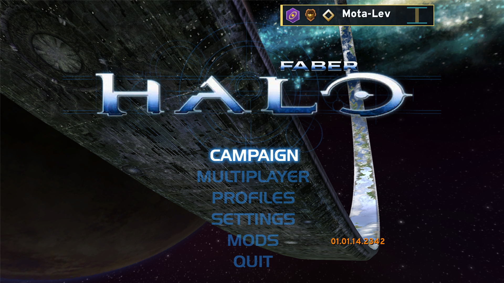
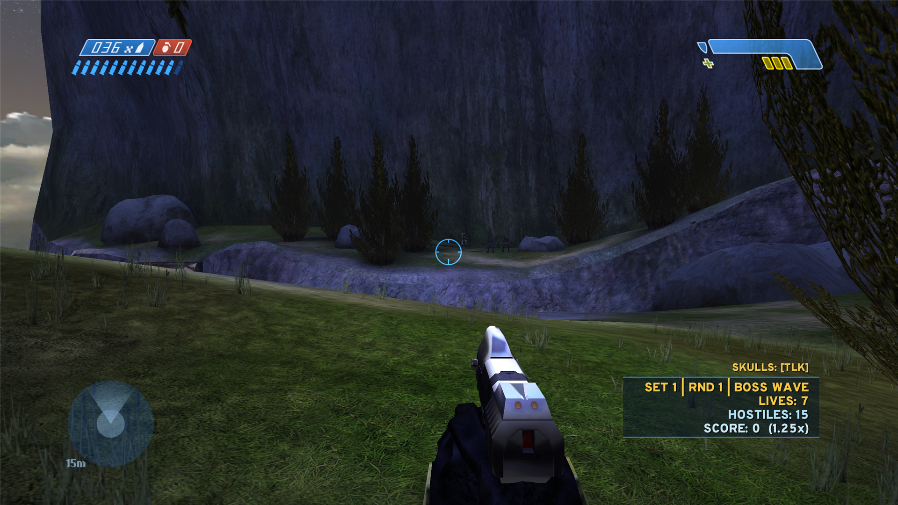
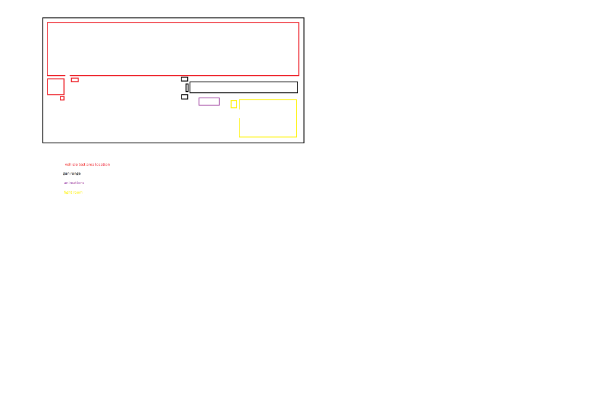

<div align="center">

# OpenCE : Faber

**An expansive Creation, Survival, Forge, Theater, and Multiplayer Suite built on [OpenCE](https://github.com/thelinkin3000/halo-ce-universal) (Halo: Combat Evolved Decompilation Port).**

[](https://github.com/SutlabSol/OpenCE-Faber/releases/latest)
[](#installation)
[](#engine--memory-upgrades-122-mb-map-limit)
[](LICENSE)

[**Download Latest Release**](https://github.com/SutlabSol/OpenCE-Faber/releases/latest) ·
[Overview & Compatibility](#expanding-on-opence--continued-compatibility) ·
[Features](#features) ·
[Installation](#installation) ·
[Building from Source](#building-from-source)



</div>

---

## Expanding on OpenCE & Continued Compatibility

**OpenCE : Faber** builds directly on the native C decompilation and cross-platform architecture of **OpenCE** (Xbox build `01.01.14.2342`), transforming Halo: Combat Evolved into a complete creation and replayable sandbox platform while preserving **100% compatibility** with standard OpenCE installations:

- **Shared Root & Zero Conflicts:** OpenCE : Faber reads your existing `maps/`, `custom_maps/`, `saves/`, `config.toml`, `brokers.txt`, and `masters.txt` directly. All Faber-exclusive tag caches, custom UI panels, marker bundles, and creator attributions live cleanly inside `Faber_data/`.
- **Standalone or Drop-In:** You can either download the **Full Standalone Release** (which includes `OpenCE - Faber.exe`, `halo.exe`, `SDL3.dll`, `brokers.txt`, `masters.txt`, and `Faber_data/`) or drop `OpenCE - Faber.exe` and `Faber_data/` straight into an existing OpenCE directory.
- **Cross-Compatible Custom Maps:** Maps forged or modified in **OpenCE : Faber** export as standard Halo Custom Edition `.map` files in `custom_maps/`, complete with baked tags and AI encounters, so they can be hosted and P2P-shared with standard OpenCE players.
- **Original Campaign & Upgrades Intact:** All upstream OpenCE features—including 128-player P2P/LAN netcode, 4-player split-screen, Campaign Co-Op, the Enemy & Weapon Randomizer, 40 Skulls, Daily Challenges, and High-Res HUD/Text—remain fully intact.

> [!IMPORTANT]
> **No proprietary game maps or copyrighted assets are included in this repository or its releases.** You must supply your own Halo: Combat Evolved `maps/` (or Xbox `.iso` / `.xiso` disc image) and optional Halo Custom Edition `custom_maps/`. On first launch in Forge or the Creation Hub, OpenCE : Faber builds your local tag cache in `Faber_data/cached_tags/` directly from your own maps.

---

## Features

### 1. Unified Select Gamemode Hub
Opening **Multiplayer** presents the Halo Custom Edition-styled **Select Gamemode** hub with seven dedicated modes:
- **STANDARD:** Classic Halo CE Multiplayer & Co-Op Campaign over Split-Screen, System Link (LAN), or Internet Play (up to 128 players).
- **RANKED:** Competitive skill-ranked playlists featuring persistent Halo 3-style **1–50 Skill Ranks** alongside Career XP progression.
- **FIREFIGHT:** Wave-based survival on **any** Campaign or Multiplayer map with dynamic dropships, Pelicans, skulls, and generator defense.
- **FORGE:** Real-time 3D In-Engine World Editor & Multiplayer Co-Op Sandbox with cross-map `.ftag` runtime cloning.
- **THEATER:** Automatic match film recording (`.ocreplay`) and in-engine replay playback with free-roam camera director controls.
- **CREATION HUB:** Map creation wizard, live in-game Tag Editor, custom tag cache manager, and the **4-Zone Forerunner Firing Range**.
- **DEDICATED SERVER:** In-game Dedicated / Listen Server Director, map rotation builder, one-click CLI generator, and live Web Admin Panel.

---

### 2. Firefight 2.0 — Wave Survival on Any Map



Play Halo: ODST / Reach-style **Firefight** across **every** Campaign mission and Multiplayer map (including custom maps):
- **Sets, Rounds, Waves & Bonus Rounds:** Structured 5-wave rounds, boss waves with high-ranking commanders, and timed Bonus Rounds with skull multipliers.
- **Dynamic 3D Dropships & Pelicans:** Covenant Spirit Dropships (`c_dropship`) physically descend along 3D flight paths to deploy enemy squads, while UNSC Pelicans (`pelican`) fly in between sets to drop allied Marines, ODSTs, and weapon resupplies.
- **3D Generator Defense:** Optional objective mode spawning physical, destructible Forerunner/Covenant field generators (`c_field_generator` / `c_uplink`) that Covenant squads actively target and players must defend.
- **Progressive Firefight Skulls:** Skulls (`Tough Luck`, `Catch`, `Fog`, `Famine`, `Tilt`, `Mythic`, `Iron`, `Black Eye`, and more) activate progressively per set or can be customized in the pre-game lobby.
- **Custom Firefight HUD Banner:** Real-time wave status (`SET | RND | WAVE`), active skull badges, shared team lives pool, remaining hostiles counter (with automatic straggler radar reveal), and live score multiplier readout.

---

### 3. 3D Forge Mode & Local Tag Cache (`Faber_data/`)
Edit any map in real time, solo or in online Co-Op Forge sessions:
- **3D Monitor Flight & Physics Beam:** Press **`B`** (or **`Tab`**) to toggle between your Spartan and 3D Monitor mode. Grab, move, rotate (Pitch / Yaw / Roll with angle snapping), clone, lock, and delete objects in 3D space.
- **Cross-Map Runtime Tag Cloning (`.ftag`):** Spawn vehicles, weapons, scenery, interactive machines/doors, bipeds, gametype markers, and live AI combat units from across the entire Campaign and Custom Edition library into any map at runtime.
- **Active In-Engine AI Placement:** Spawn Friendly or Enemy AI actors (`Marines`, `Elites`, `Grunts`, `Jackals`, `Hunters`, `Flood`, `Sentinels`) that immediately initialize with combat perception and pathfinding, and bake directly into `scenario->ai_encounters` when exported.
- **First-Launch Local Tag Cache Builder:** Automatically indexes and extracts `.ftag` bundles and embedded diffuse bitmaps from your local `maps/` and `custom_maps/` into `Faber_data/cached_tags/` on first use, recording full creator attributions in `Faber_data/credits.md`.
- **Standalone `.map` Export (`[F5]`):** Save your creation to `custom_maps/<map_name>.map`, with its preview thumbnail and description stored inside the map (drop a `Faber_data/custom_bmp/<map_name>.bmp` to use your own thumbnail), so anyone can play it without needing extra tag packs.

> [!NOTE]
> Forge is currently built into the Windows build only.

---

### 4. Creation Hub, In-Game Tag Editor & 4-Zone Forerunner Firing Range

<div align="center">

</div>

The **Creation Hub** streamlines map authoring, weapon/character tuning, and live combat testing without leaving the game:
- **Create / Edit a Map:** Choose your new map's name, pick any base map to build from, inject cached weapons, vehicles, and AI actors directly into the map file, and launch straight into the editor or test range.
- **Live In-Game Tag Editor:** Tune weapon and actor tag parameters in real time—including fire rate, rounds per second, damage min/max, spread cones, recoil, projectile velocity, magazine capacity, reserve ammo, and AI shield/body vitality—and commit edits back to your tag cache or target map.
- **4-Zone Forerunner Firing Range:** A purpose-built Forerunner testing facility featuring distant `a30`-style Forerunner beam emitter structures and **5 interactive `c_uplink` computer terminals** (walk up to any terminal and press **`E`** to open its Halo CE configuration menu):
  1. **35m Gun Range Corridor (`35m × 2m`):** Features a central weapon spawn table flanked by the **Weapon Dispenser** terminal on the left and the **Target Settings** terminal on the right. Configure target type, shields/health, and range (`5m–30m`) while tracking live HUD ballistics telemetry: **DPS**, **TTK (Time-to-Kill)**, **Spread Circle Diameter (m)**, and **Accuracy %**.
  2. **Vehicle & Flight Test Arena (`40m × 25m × 50m` Open-Roof Skybox):** Includes a **Vehicle Spawner** terminal & spawn pad alongside a **Track AI Settings** terminal to spawn AI targets inside the track. Exiting the arena automatically cleans up active track AI and optionally despawns unattended vehicles.
  3. **Animation & Model Inspection Zone:** Equipped with an **Animation Inspector** terminal and live mirror view to inspect 1st/3rd-person weapon and biped animation states.
  4. **Enclosed AI Fight Room:** Features a **Fight Room AI** terminal outside the doorway to spawn active combat AI bipeds that move, strafe, and shoot back inside the arena (and automatically despawn when the player exits the room).

---

### 5. Theater Mode & Saved Films (`.ocreplay`)
Relive and analyze your best Campaign, Firefight, and Multiplayer matches:
- **Automatic Film Recording:** Matches are automatically recorded to lightweight `.ocreplay` film files in `replays/`.
- **Halo CE Theater Browser:** Browse recent games, save favorite films permanently, rename clips, or delete old recordings.
- **In-Engine Director Controls:** Watch films back in the live engine with 1st-person POV, 3rd-person follow cam, or free-roam detached flycam, plus pause, slow-motion (`0.25x` / `0.5x`), fast-forward (`2x` / `4x`), and timeline skip controls.

---

### 6. Dedicated Server Director & Web Admin Dashboard
Host and manage servers directly from the game UI or headlessly via CLI:
- **In-Game Server Setup Screen:** Configure Server Name, UDP Port, Max Players, Public/Private listing, Password, Map & Gametype Rotation Presets, AI Bot fill count/difficulty, and Web Admin Port.
- **Instant Listen Server or Headless CLI:** Start hosting immediately in-game, or click **Copy CLI Command** to copy the exact `--server` command line for a headless Windows/Linux dedicated server.
- **Embedded Web Admin Panel (`http://127.0.0.1:8080`):** Includes a built-in dark-themed Web Admin Dashboard accessible from any browser for live player/scoreboard monitoring, advancing the map rotation, kicking/banning players, and executing RCON console commands.

---

### 7. AI Bots & Dynamic Scoring Multipliers
- **Configurable AI Bots:** Add `0–15` AI Bots with selectable difficulty (`Easy`, `Normal`, `Heroic`, `Legendary`) to Multiplayer matches, Campaign Co-Op, and Firefight sessions.
- **Dynamic Score Multipliers:** Campaign and Firefight scoring dynamically scales your point multiplier based on base difficulty, active skulls, enemy bot density, and allied bot assistance.

---

### 8. Service Record, Career Ranks & Spartan Customization
- **Halo 3 / MCC-Style Progression:** Earn persistent Career XP and climb through military ranks and **1–50 Competitive Skill Ranks**, rendered live on the top-right Main Menu nameplate and in-game scoreboard.
- **Service Record & Medal Chest:** View lifetime Kills, Deaths, K/D Ratio, Campaign & Firefight high scores, and a visual **Medal Chest** tracking every earned spree and multikill medal.
- **2-Layer Emblem & Armor Customization:** Customize your Spartan's armor color (18 colors) and build a personalized 2-layer emblem from 50 foreground icons, 32 background shapes, primary/secondary/tertiary colors, and foreground layer toggle.

---

### 9. Engine & Memory Upgrades (122 MB Map Limit)
To support massive Custom Edition overhaul maps and heavy runtime tag injection without running into Xbox memory ceiling crashes:
- **512 MB Contiguous Memory Window:** Raised the virtual Xbox contiguous memory reservation from 64 MB to **512 MB** (`0x20000000` bytes).
- **122 MB Map & Tag Cache Limit:** Increased `CACHE_FILE_MAX_SIZE` and the tag cache buffer from `23 MB` to **122 MB** (`122 * 1024 * 1024` bytes), with matching **122 MB** `bitmaps.map` resource cache support.
- **256 MB D3D Texture Heap:** Expanded the texture cache to smoothly stream high-resolution bitmaps and custom shaders across complex maps.

---

## Installation

### Requirements
You need your own copy of **Halo: Combat Evolved** map files (no `.map` files are included in this repo or release):
- **Xbox / Retail Maps (`maps/`):** Place your Xbox `.map` files (or an Xbox `.iso` / `.xiso` disc image, which the game will automatically unpack on first launch) into the `maps/` folder beside the executable.
- **Custom Edition Maps (`custom_maps/` — Optional, Recommended for Forge & Creation Hub):** Place Halo Custom Edition `.map` files along with `bitmaps.map`, `sounds.map`, and `loc.map` inside `custom_maps/`.

---

### Option A: Full Standalone Release (Recommended)
Use `OpenCE-Faber-Windows-Full.zip` from [Releases](https://github.com/SutlabSol/OpenCE-Faber/releases/latest) if you want a complete, ready-to-run installation:
1. Download **`OpenCE-Faber-Windows-Full.zip`** from the [Releases](https://github.com/SutlabSol/OpenCE-Faber/releases/latest) page and extract it to a new folder (e.g. `C:\Games\OpenCE-Faber\`).
2. Copy your `maps/` folder (or Halo Xbox `.iso` / `.xiso`) and optional `custom_maps/` folder into that directory.
3. Launch **`OpenCE - Faber.exe`** (or `halo.exe`).

```text
OpenCE-Faber/
├── OpenCE - Faber.exe      # Primary OpenCE : Faber executable
├── halo.exe                # Standard executable name (identical build, for launcher/URI compatibility)
├── SDL3.dll                # SDL3 runtime library
├── brokers.txt             # P2P lobby broker list
├── masters.txt             # Custom Edition master server list
├── Faber_data/             # Faber UI assets, marker tags, custom_tags/, and local cached_tags/
├── maps/                   # (User-provided) Halo Xbox / PC campaign & multiplayer .map files
└── custom_maps/            # (User-provided) Halo Custom Edition .map files & resource maps
```

---

### Option B: Drop-In Overlay for an Existing OpenCE Folder
Use `OpenCE-Faber-DropIn.zip` if you already have an existing OpenCE installation setup with your maps, saves, and `config.toml`:
1. Download **`OpenCE-Faber-DropIn.zip`** from the [Releases](https://github.com/SutlabSol/OpenCE-Faber/releases/latest) page.
2. Extract **`OpenCE - Faber.exe`** and the **`Faber_data/`** folder directly into your existing OpenCE folder alongside `halo.exe` and `SDL3.dll`.
3. Launch **`OpenCE - Faber.exe`**. It will automatically use your existing `maps/`, `custom_maps/`, `saves/`, and `config.toml`.

---

## Building from Source

### Prerequisites (Windows)
- **Python 3.9+**
- **Ninja** (`ninja`)
- **LLVM / Clang** (`clang`, `lld-link`, `llvm-rc`, `llvm-objcopy`) targeting `i686-pc-windows-msvc`
- **Visual Studio Build Tools / Windows SDK** (32-bit x86 MSVC CRT & Windows SDK headers/libs)

*(SDL3 is downloaded and verified automatically by `configure.py` into `build/windows/third_party/`.)*

### Compile
```powershell
python configure.py
ninja windows
```
This builds:
- `build/windows/halo.exe`
- `build/windows/OpenCE - Faber.exe`
- `build/windows/SDL3.dll`
- `build/windows/brokers.txt` & `build/windows/masters.txt`
- `build/windows/Faber_data/`

### Other platforms
The Linux, Android and web builds (`ninja linux`, `ninja android`, `ninja web`; see [AGENTS.md](AGENTS.md) and the READMEs under `port/`) compile everything in `port/linux/game/`, including Firefight, Theater, the firing range, the tag editor and the server director, but **not Forge** (`port/forge/`), which is Windows-only for now. See [port/forge/assets/README.md](port/forge/assets/README.md).

---

## Credits & License
- **OpenCE : Faber** is developed by **SutlabSol**, expanding upon the [OpenCE](https://github.com/thelinkin3000/halo-ce-universal) project.
- Built on the decompilation of Halo: Combat Evolved (`01.01.14.2342`) and the OpenCE cross-platform runtime layer.
- Community custom map tags extracted by the local tag cache builder are automatically attributed to their original map creators in `Faber_data/credits.md`.
- Licensed under the [GNU Affero General Public License v3.0 or later (`AGPL-3.0-or-later`)](LICENSE). Each vendored library's licence, version and upstream are listed in its README under [`port/third_party/`](port/third_party).
